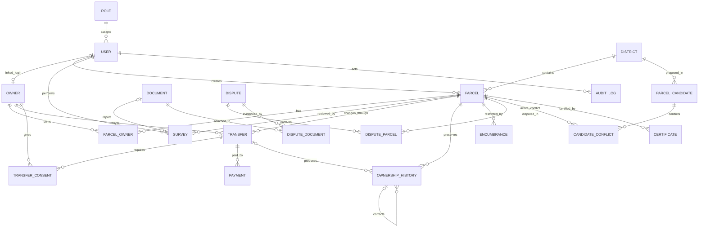

# Database design

## Table overview

- `roles`, `users`: the five account roles and login identities.
- `owners`: legal people/companies, optionally linked one-to-one to an account.
- `districts`, `parcels`: administrative location, atomic district number counter, idempotency key, and authoritative Polygon/4326 parcel records.
- `parcel_owners`: many-to-many ownership with exact decimal shares.
- `surveys`, `documents`: repeatable survey attempts, exact verified boundary/area, and metadata-only private evidence attachments.
- `transfers`, `transfer_consents`, `payments`: future ownership-change workflow.
- `ownership_history`: immutable legal snapshots for registration, transfer, and correction events.
- `encumbrances`: active/lifted mortgage and court holds.
- `disputes`, `dispute_parcels`, `dispute_parties`, `dispute_documents`: authoritative cases, affected parcels, and claimant snapshots.
- `parcel_candidates`, `candidate_conflicts`: proposed rejected boundaries and overlap evidence, without pretending rejected land is registered.
- `certificates`: versioned title snapshots and verification tokens.
- `fee_settings`, `audit_logs`, `sms_outbox`: configuration, immutable security evidence, and simulated notifications.

## Entity relationships

Primary keys uniquely identify rows. Foreign keys ensure references point to real records. Most legal records use `RESTRICT` on delete so a user, parcel, owner, or transfer cannot be removed while history depends on it.

## Geometry

`parcels.geometry` and `parcel_candidates.proposed_geometry` are PostGIS `geometry(Polygon,4326)`. Longitude is first, latitude second. Database checks require SRID 4326, a valid polygon, at least three distinct exterior corners, and positive stored area. GiST indexes accelerate intersection searches.

Area and overlap use a `geography` cast so results are square metres rather than angular degrees. `ST_Intersects` may be true for a shared boundary, while `ST_Area(ST_Intersection(...))` is zero; only overlap above 1 m² is blocking.

Prisma 7 exposes these columns as `Unsupported`, so `geometry.service.js` uses `$queryRaw` tagged templates with `ST_GeomFromGeoJSON`, `ST_IsValid`, `ST_Area`, `ST_Intersection`, `ST_Intersects`, and `ST_AsGeoJSON`. Inputs are bound values, not concatenated SQL.

## Ownership integrity

`parcel_owners.share_percent` is `Decimal(5,2)` with a per-row range check. A cross-row total cannot be honestly enforced by a normal `CHECK`, so `validateOwnershipShares` adds exact decimal values and requires precisely 100 before an approval workflow commits. The approval and history insert should be performed in one transaction.

Each history row contains a JSON snapshot with owner IDs, display names, and shares as they existed at the event. A trigger rejects UPDATE and DELETE. A correction inserts a `CORRECTION` row referencing the earlier entry. Audit logs use the same append-only trigger.

## Important constraints

- Unique role names, normalized unique emails, parcel numbers, owner identity/registration numbers, certificate numbers/tokens, and payment references.
- Unique `(region_code, code)`, `(parcel_id, owner_id)`, `(transfer_id, owner_id)`, and dispute/candidate join pairs.
- Owner-type checks require the correct person or company identity fields.
- A partial unique index allows only one non-final transfer per parcel.
- A partial unique index allows only one current certificate per parcel.
- Registered/disputed geometry and area changes are blocked unless a controlled transaction sets `app.boundary_change_approved=true` after the future approval checks.
- Cancellation and encumbrance checks require supporting fields.

## Migration strategy

`20261102000100_initial_registry/migration.sql` creates PostGIS first, then enums/tables/indexes/foreign keys and custom protections. `20261104000100_phase_4_6_registration/migration.sql` adds atomic counters, registration/candidate idempotency, owner snapshots, optional survey assignment, and dispute parties while initializing counters from existing numbers. `migration_lock.toml` declares PostgreSQL. Fresh databases use `prisma migrate deploy`; development schema changes use `prisma migrate dev`. `prisma db push` is not part of the workflow.

`20261104000200_phase_7_survey_approval/migration.sql` adds document size, verified survey geometry/area, a verified-survey evidence constraint, and a partial unique index allowing only one initial `REGISTRATION` history event per parcel. Ownership history and audit triggers continue to reject updates and deletes.

The repeatable seed uses upserts and conflict-safe inserts. It calculates parcel areas in PostgreSQL, hashes `DEMO_PASSWORD`, and never creates a registered parcel with incomplete shares.
