# Ownership and transfer flow

## Model

`Owner` is the legal identity; `User` is a login. The optional, unique `Owner.userId` link is created by trusted registry data/seed setup, never selected in a request body. `ParcelOwner` stores only the current title allocation. Joint rows must be unique, positive, and total exactly 100 using `Prisma.Decimal`.

Pending registration rows can contain proposed `ParcelOwner` allocations for the existing registration workflow. Official ownership reads therefore require an immutable `REGISTRATION` event. `OwnershipHistory` stores the after-event owner names and shares as JSON, so later profile/title changes cannot rewrite the past. PostgreSQL triggers prohibit history UPDATE and DELETE.

## Whole-parcel SALE

```mermaid
flowchart LR
  A[Seller initiates] --> B[All current owners consent]
  B --> C[Buyer accepts]
  C --> D[Documents uploaded]
  D --> E[Clerk checks completeness]
  E --> F[Phase 11 records PAID]
  F --> G[Registrar revalidates]
  G --> H[Atomic ownership replacement]
  H --> I[SALE history appended]
  I --> J[Old certificate superseded]
  J --> K[Replacement certificate generated]
```

Initiation preserves every current seller and exact share. Decline/rejection/cancellation finalizes the record without changing title. Clerk review verifies document completeness but has no legal approval power. There is no public paid endpoint: until Phase 11 writes a trusted `PAID` row, registrar approval returns `Payment required before approval.`

Approval holds the same registry advisory lock used by registration plus a transfer row lock. It rechecks current official ownership against the seller snapshot, all consents, buyer acceptance, clerk review, payment, disputes, and encumbrances. One transaction deletes old current rows, creates the buyer's 100% row, appends the unique SALE history event, marks the transfer approved, supersedes any current certificate, invalidates stale pending generation, and writes audits. A failure rolls everything back. Certificate PDF/R2 work runs after this legal transaction: failure cannot roll back the completed transfer and leaves a recoverable pending state.

GIFT, INHERITANCE, COURT_ORDER, and partial-share transfers are deliberately unavailable until their distinct legal authorization rules are defined. Phase 10 does not force an inheritance decedent to sign a voluntary-sale consent.

## Twelve important functions

1. `ownership.service.js — validateOwnershipShares(owners)`: receives allocations, checks every decimal share/uniqueness at callers, and rejects any total other than 100.
2. `ownership.service.js — getLinkedOwner(userId)`: maps a verified login to its legal Owner or returns 403; this prevents body-controlled identity claims.
3. `ownership.service.js — getCurrentOwners(parcelId, actor)`: authorizes staff/current owners, verifies official registration, and returns privacy-safe current shares.
4. `ownership.service.js — getOwnershipHistory(parcelId, actor)`: applies the same access rule and returns stable chronological snapshots.
5. `ownership.service.js — getParcelsOwnedByUser(userId, query)`: derives identity from authentication and paginates only current official parcels.
6. `transfer.service.js — initiateTransfer(input, actor)`: validates an available SALE, restrictions, buyer, exact shares, snapshot, open-transfer uniqueness, consents, and audit.
7. `transfer.service.js — respondToConsent(id, decision, actor)`: allows only the linked required seller to answer once and advances only after every confirmation.
8. `transfer.service.js — respondAsBuyer(id, decision, actor)`: allows only the linked buyer to accept/reject and sends acceptance to clerk review.
9. `transfer.service.js — saveTransferDocument(id, file, actor)`: verifies authorization, MIME/signature/size, stores randomized private bytes, metadata, link, and audit.
10. `transfer.service.js — reviewTransferDocuments(id, input, actor)`: requires a real document and records clerk completeness/return notes without changing title.
11. `transfer.service.js — approveTransfer(id, actor)`: locks, revalidates every legal gate, replaces current title, appends history, supersedes certificate, and audits atomically.
12. `transfer.service.js — getTransfer(id, actor)`: limits details/documents to staff and participants and exposes real requirement/payment/timeline state.

## Judge questions

1. **Why separate Owner and User?** Legal identities may exist without accounts; logins can be disabled without deleting title.
2. **How can a parcel have several owners?** One `ParcelOwner` row per parcel/owner stores a decimal share.
3. **How are shares validated?** Exact decimal arithmetic requires positive unique allocations totaling 100.00.
4. **How is an unauthorized sale stopped?** The service derives Owner from the authenticated user and verifies current official ownership.
5. **What if one joint owner declines?** The transfer becomes REJECTED and title is unchanged.
6. **Who can accept as buyer?** Only the User uniquely linked to `buyerOwnerId`.
7. **Why does the clerk review documents?** To establish file completeness; only a registrar changes legal title.
8. **Why registrar approval?** It is the final role-separated legal decision after all gates.
9. **How are double sales stopped?** A partial unique database index permits one open transfer per parcel.
10. **What about two concurrent approvals?** Advisory/row locks serialize them and unique transfer history prevents duplicate events.
11. **Why a transaction?** Ownership, history, status, certificate, and audits must all commit or all roll back.
12. **How is history immutable?** A PostgreSQL trigger rejects UPDATE/DELETE; corrections are appended events.
13. **What happens on cancellation?** A reason is stored, status becomes final, and ownership never changes.
14. **Why do disputes/encumbrances block?** They represent unresolved legal restrictions on title transfer.
15. **How are previous owners preserved?** Each registration/sale event stores its own names and exact shares snapshot.
16. **Can the client mark payment paid?** No. Phase 11 must create a trusted `PAID` database record.
17. **What if replacement PDF generation fails?** The legal transfer remains approved, the old certificate remains superseded, and the pending certificate can be retried safely.

## Demo

1. Sign in as `owner@example.com`, open **My parcels**, start a SALE, and select `Sahra Maxamed`.
2. Confirm the seller consent. For joint parcels, each linked joint owner must separately confirm.
3. Sign in as `buyer@example.com` and accept under **My transfers**.
4. Upload a PDF/JPEG/PNG, sign in as the clerk, and approve document completeness.
5. Sign in as registrar: approval remains disabled and the API rejects it until Phase 11 records payment.
6. With a controlled `PAID` fixture, approve and observe buyer 100%, the appended SALE timeline, and certificate-reissue notice.
